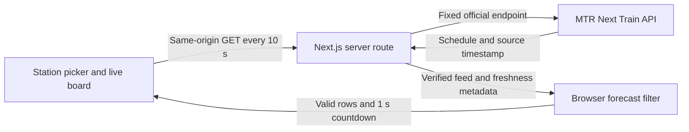

**English** | [繁體中文](README.zh-Hant.md)


<div align="center">
  <a href="https://mtr-live-rosy.vercel.app">
    
  </a>

  <p><strong>Official train forecasts. A clear view of your next journey.</strong></p>
  <p>An independent arrival board for Hong Kong's MTR network, with station displays in English and Traditional Chinese.</p>

  <p>
    <a href="https://mtr-live-rosy.vercel.app"><strong>Open live website</strong></a>
    · <a href="https://mtr-live-rosy.vercel.app/?line=SIL&amp;station=OCP">Ocean Park</a>
    · <a href="https://mtr-live-rosy.vercel.app/?line=TWL&amp;station=ADM">Admiralty</a>
  </p>

  <p>
    
    
    
    
  </p>
</div>

## Screenshots

Captured from the production website on **12 October 2026** (Hong Kong, `UTC+08:00`). Train forecasts and source times reflect the capture moment; [open the live website](https://mtr-live-rosy.vercel.app) for current information. Select any image to view it at full size.

<table>
  <tr>
    <td width="70%" align="center" valign="top">
      <p><strong>Desktop · Ocean Park</strong><br>Official destinations, platforms and forecasts</p>
      <a href="docs/assets/screenshots/desktop-ocean-park.jpg"></a>
    </td>
    <td width="30%" align="center" valign="top">
      <p><strong>Mobile · Station chooser</strong><br>Search and line filters</p>
      <a href="docs/assets/screenshots/mobile-station-chooser.jpg"></a>
    </td>
  </tr>
</table>

<table>
  <tr>
    <td width="50%" align="center" valign="top">
      <p><strong>Admiralty · Group 1</strong><br>Tsuen Wan + Island lines</p>
      <a href="docs/assets/screenshots/admiralty-group-1.jpg"></a>
    </td>
    <td width="50%" align="center" valign="top">
      <p><strong>Admiralty · Group 2</strong><br>South Island + East Rail lines</p>
      <a href="docs/assets/screenshots/admiralty-group-2.jpg"></a>
    </td>
  </tr>
</table>

Admiralty's two groups rotate every **12 seconds** on the live website when automatic rotation is enabled.

## At a glance

MTR Live turns the official Next Train feed into a focused station board: destination, platform, forecast time and a live countdown. Choose a station, save a home station, or follow a direct link to a board. When a forecast cannot be verified, the interface explains the problem and hides that line's train rows.

| Capability | What you can do |
| --- | --- |
| Network coverage | Browse **10 supported railway lines**, **98 distinct stations** and **121 line–station combinations**. |
| Station selection | Search by Chinese or English name, station code or line; use a desktop dialog or a mobile bottom sheet. |
| Home station | Start with Ocean Park, or save another station locally in your browser. |
| Interchange boards | See all supported feeds for the selected physical station, with dedicated Admiralty groups. |
| Bilingual display | Switch between English and Traditional Chinese without leaving the current board. |
| Live information | Read official destinations, platforms and forecasts, with clear delay and availability notices. |

Coverage includes Airport Express, Tung Chung, Tuen Ma, Tseung Kwan O, East Rail, South Island, Tsuen Wan, Island, Kwun Tong and Disneyland Resort. Light Rail, MTR buses and High Speed Rail use separate services and are outside this application's scope.

**Admiralty** combines Tsuen Wan + Island lines in one group (platforms 1–4) and South Island + East Rail lines in another (platforms 5–8). Groups rotate every **12 seconds** and support manual selection, swiping and pause controls. Each train's platform still comes from the live feed.

## Run locally

Use **Node.js 24.x** and npm. The application requires no API key, MTR account, database or environment variables.

```sh
git clone https://github.com/computersciencefreshmen/mtr-live.git
cd mtr-live
npm ci
npm run dev
```

Open [localhost:3000](http://localhost:3000). For a local production build:

```sh
npm run build
npm start
```

## How it works

The browser fetches only the selected station's supported line feeds. A small server route keeps upstream access at a fixed official origin and verifies the source timestamp before returning data. The browser filters individual forecasts and advances the countdown using elapsed time.



The same-origin route is `/api/next-train?line=SIL&sta=OCP`. It validates the line–station pair, applies an upstream timeout and returns `no-store` cache headers. The train-data source is exclusively the [official MTR endpoint](https://rt.data.gov.hk/v1/transport/mtr/getSchedule.php?line=SIL&sta=OCP).

| Location | Responsibility |
| --- | --- |
| [`app/live-board.tsx`](app/live-board.tsx) | Selected station, live polling, display clock, language and group rotation. |
| [`app/station-chooser.tsx`](app/station-chooser.tsx) | Search, line filters, responsive dialog and keyboard focus handling. |
| [`app/api/next-train/route.ts`](app/api/next-train/route.ts) | Dynamic same-origin API entry point. |
| [`lib/next-train.ts`](lib/next-train.ts) | Official upstream request, response validation and freshness metadata. |
| [`lib/verified-arrivals.ts`](lib/verified-arrivals.ts) | Forecast validation, expiration and per-direction limits. |
| [`lib/mtr-stations.ts`](lib/mtr-stations.ts) · [`lib/station-displays.ts`](lib/station-displays.ts) | Supported station registry and interchange display groups. |

## Data integrity

**No simulated, prerecorded or alternative train feed is used.** Failed requests, official service alerts, unverifiable timestamps and stale data produce availability messages; they never become fabricated train rows.

| Timing rule | Behavior |
| --- | --- |
| **10 seconds** | Request fresh data for the selected station's feeds. |
| **1 second** | Recalculate the display countdown and remove elapsed forecasts. |
| **45 seconds** | Maximum source age; stale feeds stop displaying train rows. |
| **12 seconds** | Rotate Admiralty's two display groups when automatic rotation is enabled. |

Forecasts are parsed in Hong Kong time (`UTC+08:00`). The countdown advances from the verified official timestamp and monotonic browser elapsed time, so changing the visitor's wall clock does not change the forecast. Each direction is **filtered before taking its first two records**: the forecast must have a real calendar date at or after the verified current time, a destination on the same line and a valid platform value.

<details>
<summary><strong>Arrival, departure and other forecast semantics</strong></summary>

- **“Arriving / 即將抵達” is an ETA estimate within 60 seconds**, not confirmation that the train has physically entered the station.
- The official `timeType` field takes precedence over the older `timetype` spelling. **`D` keeps departure wording and the minute countdown**; it is never labeled as arriving. Unknown types, and East Rail records without a type, use neutral forecast wording.
- Official shared platform strings such as `1/3` are preserved. `route=RAC` identifies a service via Racecourse.
- The API's dummy fields `ttnt`, `valid` and `source` are not treated as authoritative arrival information. Empty or unverified directions have no train rows; the status message appears outside the train list.

</details>

## Verify changes

```sh
npm run typecheck
node scripts/check-verified-arrivals.mjs
npm run build
```

The filter checks cover malformed records, calendar dates, millisecond expiration, midnight, same-line destinations, shared platforms, record order, limits and arrival/departure semantics. Their fixed examples exercise validation boundaries only; they are never connected to the application's live feed.

For end-to-end checks, start the production build and inspect Ocean Park (`SIL-OCP`) plus Admiralty's `TWL`, `ISL`, `SIL` and `EAL` feeds through `/api/next-train`. During normal service, a usable response has HTTP `200`, official `status=1` and a verified source age within the 45-second window. Outside service hours or when no forecast is available, report that state accurately. Also check mobile station selection, both Admiralty groups and both display languages.

<details>
<summary><strong>Open the five production API feeds</strong></summary>

| Station | Line | Live JSON |
| --- | --- | --- |
| Ocean Park | South Island | [`SIL-OCP`](https://mtr-live-rosy.vercel.app/api/next-train?line=SIL&sta=OCP) |
| Admiralty | Tsuen Wan | [`TWL-ADM`](https://mtr-live-rosy.vercel.app/api/next-train?line=TWL&sta=ADM) |
| Admiralty | Island | [`ISL-ADM`](https://mtr-live-rosy.vercel.app/api/next-train?line=ISL&sta=ADM) |
| Admiralty | South Island | [`SIL-ADM`](https://mtr-live-rosy.vercel.app/api/next-train?line=SIL&sta=ADM) |
| Admiralty | East Rail | [`EAL-ADM`](https://mtr-live-rosy.vercel.app/api/next-train?line=EAL&sta=ADM) |

</details>

## Production deployment

The production site is [mtr-live-rosy.vercel.app](https://mtr-live-rosy.vercel.app). This repository's **`main` branch is connected to Vercel**; pushes trigger production builds and update that stable address.

For your own deployment, import the repository into Vercel and use the **Next.js** preset, repository root, **Node.js 24.x** and `npm run build`. Keep the GitHub integration connected and set `main` as the production branch. No application environment variables are needed. The complete publication and verification procedure is in [`CODEX_DEPLOY.md`](CODEX_DEPLOY.md).

## Official references

- [MTR train-information dataset and update frequency](https://data.gov.hk/en-data/dataset/mtr-data2-nexttrain-data)
- [Next Train API Specification v1.7](https://opendata.mtr.com.hk/doc/Next_Train_API_Spec_v1.7.pdf)
- [Next Train Data Dictionary v1.7](https://opendata.mtr.com.hk/doc/Next_Train_DataDictionary_v1.7.pdf)
- [Official line and station metadata](https://opendata.mtr.com.hk/data/mtr_lines_and_stations.csv)
- [MTR system map](https://www.mtr.com.hk/ch/customer/services/system_map.html)

The registry was checked against official sources on **11 October 2026**. Coverage counts describe the committed registry; update it from official documentation as API support changes.

## Independence and attribution

MTR Live is an **independent, unofficial project**. It is not affiliated with, endorsed by or operated by MTR Corporation. For operational decisions, check MTR's announcements and station information.

[`public/assets/mtr-logo.png`](public/assets/mtr-logo.png) is the unmodified **192 × 192** MTR mark from [MTR's original website asset](https://www.mtr.com.hk/mtrmobile/lib/app/android-icon-192x192.png), referenced by its [Next Train page](https://www.mtr.com.hk/mtrmobile/en/transport/next-train/). It was not redrawn, generated or cropped. MTR names, marks and official data belong to their respective owner; publication of this repository does not grant rights to the MTR mark or other third-party materials.
