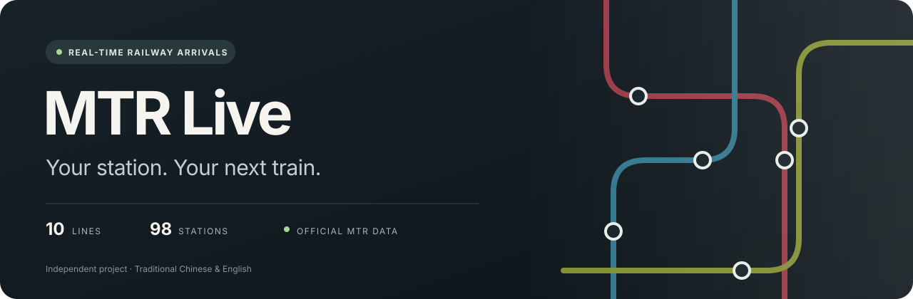
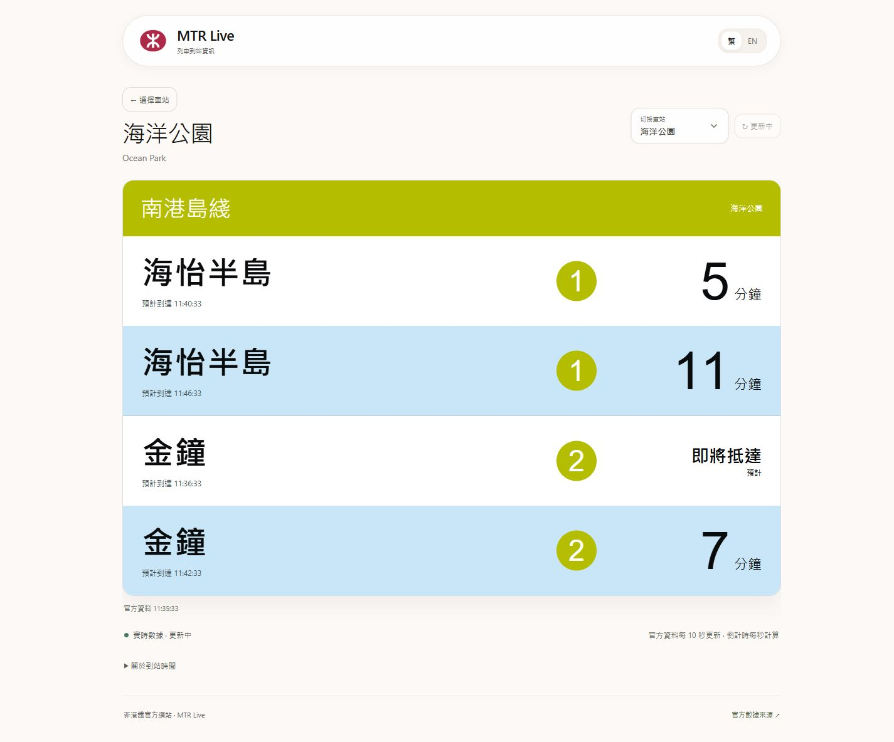
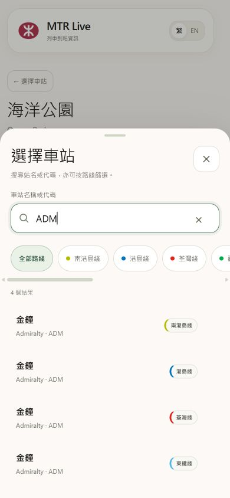
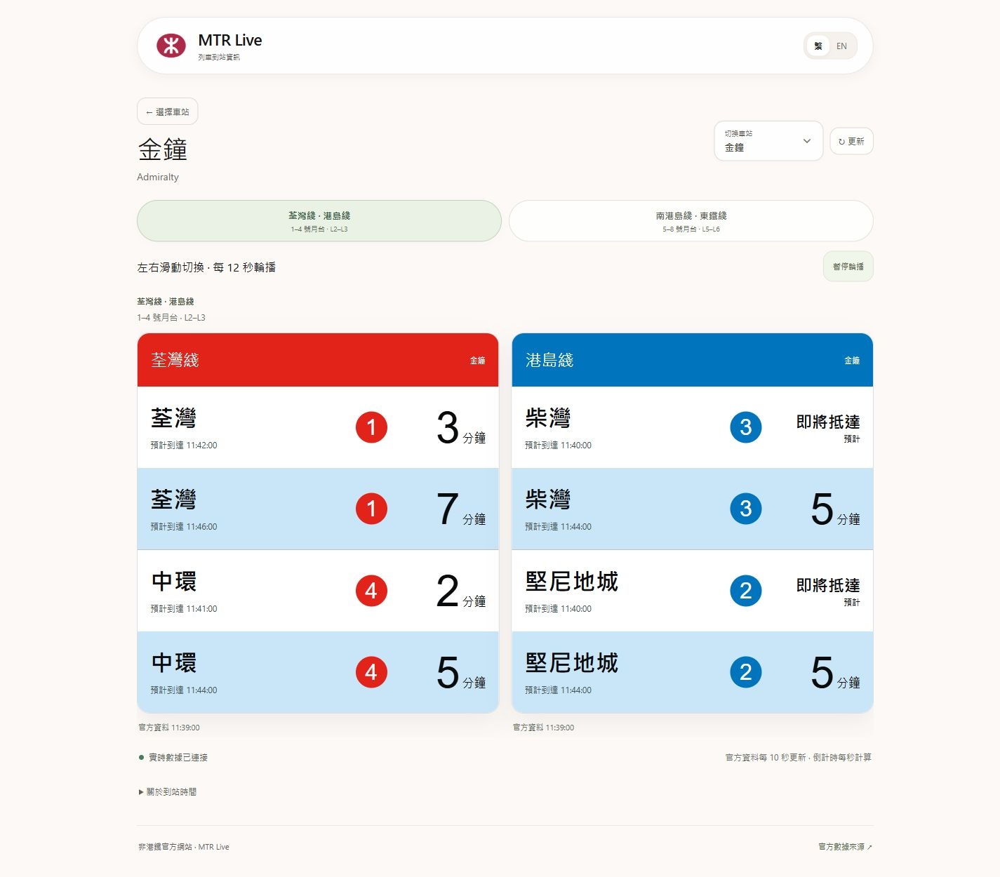
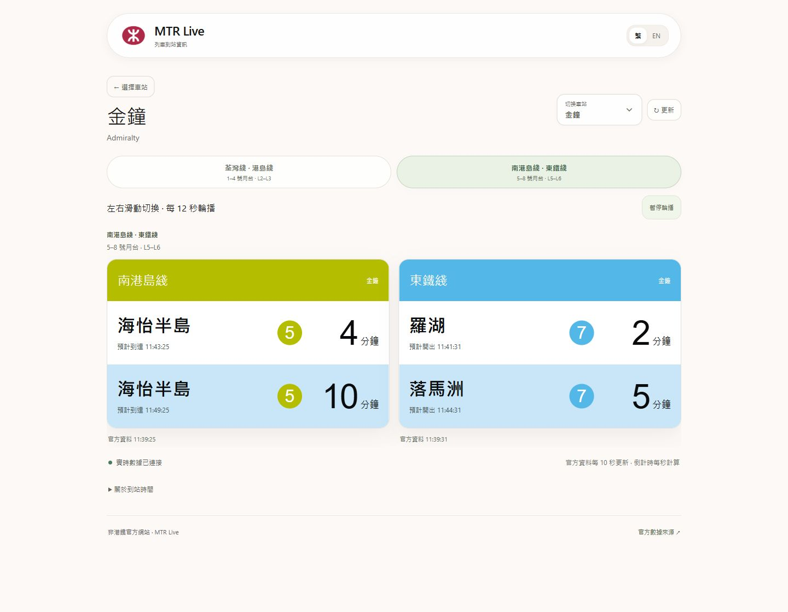
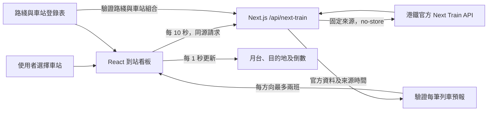

[English](README.md) | **繁體中文**



<div align="center">
  <a href="https://mtr-live-rosy.vercel.app"></a>
  <p><strong>下一班列車，清楚呈現。</strong></p>
  <p>以港鐵官方預報為唯一來源的獨立實時到站看板。<br>從手機選站到轉車站分組，保留車站資訊屏的閱讀節奏。</p>
  <p>
    <a href="https://mtr-live-rosy.vercel.app"><strong>開啟正式網站 →</strong></a>
    &nbsp;·&nbsp;
    <a href="https://mtr-live-rosy.vercel.app/?line=SIL&amp;station=OCP">海洋公園</a>
    &nbsp;·&nbsp;
    <a href="https://mtr-live-rosy.vercel.app/?line=TWL&amp;station=ADM">金鐘</a>
  </p>
  <p>
    
    
    
    
  </p>
</div>

## 實際畫面

截圖取自正式網站，拍攝日期為 **2026 年 10 月 12 日**（香港時間，`UTC+08:00`）。列車預報及來源時間只代表截圖當刻；最新資訊請[開啟正式網站](https://mtr-live-rosy.vercel.app)。點選任何圖片可查看原始尺寸。

<table>
  <tr>
    <td width="70%" align="center" valign="top">
      <p><strong>桌面 · 海洋公園</strong><br>官方目的地、月台及預報</p>
      <a href="docs/assets/screenshots/desktop-ocean-park.jpg"></a>
    </td>
    <td width="30%" align="center" valign="top">
      <p><strong>手機 · 選站面板</strong><br>搜尋及路綫篩選</p>
      <a href="docs/assets/screenshots/mobile-station-chooser.jpg"></a>
    </td>
  </tr>
</table>

<table>
  <tr>
    <td width="50%" align="center" valign="top">
      <p><strong>金鐘 · 第一組</strong><br>荃灣綫＋港島綫</p>
      <a href="docs/assets/screenshots/admiralty-group-1.jpg"></a>
    </td>
    <td width="50%" align="center" valign="top">
      <p><strong>金鐘 · 第二組</strong><br>南港島綫＋東鐵綫</p>
      <a href="docs/assets/screenshots/admiralty-group-2.jpg"></a>
    </td>
  </tr>
</table>

正式網站開啟自動輪播後，金鐘的兩組看板每 **12 秒**切換。

---

**10 條路綫 · 98 個車站 · 121 個路綫與車站組合**

MTR Live 將官方預報整理成易讀的到站看板：目的地、月台、預計時間與倒數同時呈現。選擇一個車站後，只讀取該站所屬路綫的資料。當來源失效或過期，看板會隱藏未能驗證的列車預報，並清楚交代原因。

這是一個**獨立、非官方專案**，並非由香港鐵路有限公司營運或認可。

## 體驗

| 功能 | 實際行為 |
| --- | --- |
| 車站選擇 | 支援繁體中文、英文、車站代碼搜尋及路綫篩選；桌面使用對話框，手機使用底部選站面板。 |
| 常駐車站 | 預設為海洋公園；可在瀏覽器儲存其他常駐車站，亦可隨機選站。 |
| 雙語介面 | 在看板內切換繁體中文與英文，保留官方目的地及月台資料。 |
| 轉車站看板 | 按同一實體車站的路綫整合預報；步行相連但代碼不同的車站不會混為一站。 |
| 金鐘分組 | 荃灣綫＋港島綫為一組，南港島綫＋東鐵綫為另一組；每 **12 秒**輪播，支援滑動、手動切換及暫停。 |
| 實時更新 | 每 **10 秒**取新資料，每 **1 秒**更新時間顯示；每個方向最多顯示兩班通過驗證的列車。 |
| 無效資料處理 | 官方服務通知、逾時、無法驗證的時間及過期資料均有明確狀態；沒有虛構列車作後備。 |

金鐘的分組說明對應 1–4 號及 5–8 號月台；**個別列車的月台號碼始終取自官方實時紀錄**，並非由分組推算。

## 資料可信度

唯一列車資料來源為港鐵 Next Train API：

```text
https://rt.data.gov.hk/v1/transport/mtr/getSchedule.php
```

本專案沒有模擬、錄製或替代列車資料源。看板遵循以下規則：

1. **先驗證來源，再顯示倒數。** 官方狀態必須為 `1`，車站紀錄及來源時間必須有效。資料超出 **45 秒**新鮮度窗口時，該路綫的列車列表會隱藏，並停止實時倒數。
2. **先過濾，再取兩班。** 每個方向依官方陣列順序，剔除已過時或格式錯誤的預報，再取最多兩班。目的地必須屬於該路綫，月台必須有效；沒有有效預報就不顯示列車行。
3. **時間以香港為準。** 預報時間以 `UTC+08:00` 解析。倒數由已驗證的官方時間及瀏覽器經過時間推進，避免訪客裝置時鐘誤差影響讀數。回應使用 `no-store`，避免快取冒充新資料。
4. **保留官方語義。** `timeType` 優先於舊式 `timetype`；`D` 保留「預計開出」語義，`route=RAC` 顯示「經馬場」。未知時間類型保持中性「預計時間」，不猜測到達或開出；東鐵綫缺少時間類型時亦如此。
5. **估算不當作確認。** 「即將抵達」指符合條件、預計 **60 秒內**到達的 ETA 估算，並不代表已確認列車駛入車站。官方共用月台值（例如 `1/3`）會原樣保留；`ttnt`、`valid`、`source` 等 dummy 欄位不作到站判斷依據。

官方非服務時段或沒有預報時，介面會如實呈現可用狀態。單一路綫取數失敗，不會令其他仍通過驗證的路綫失去可用資料。

## 系統架構

一個 Next.js 專案同時提供網頁與同源 API：瀏覽器負責互動及倒數，伺服器負責固定官方端點的請求及來源驗證。毋須獨立後端、資料庫或 API 金鑰。



伺服器路由只接受登錄表中的有效路綫與車站組合，不接受任意上游網址。純函式 `getVerifiedTrains` 集中處理列車驗證，讓畫面呈現與資料判斷各自有清楚責任。金鐘輪播則由顯示分組管理，不改寫官方列車資料。

## 本地啟動

使用 **Node.js 24.x** 與 npm。應用程式不需要環境變數、港鐵帳戶或 API 金鑰。

```sh
git clone https://github.com/computersciencefreshmen/mtr-live.git
cd mtr-live
npm ci
npm run dev
```

開啟 [http://localhost:3000](http://localhost:3000)。首頁為選站入口；[海洋公園看板](http://localhost:3000/?line=SIL&station=OCP)及[金鐘看板](http://localhost:3000/?line=TWL&station=ADM)可直接開啟。

執行部署前檢查：

```sh
npm run typecheck
node scripts/check-verified-arrivals.mjs
npm run build
npm start
```

驗證腳本的固定案例只用於測試過期、格式及時間類型等邊界，**不會接入應用程式或取代正式網站的官方資料源**。

### 驗證真實 API

本地伺服器啟動後，檢查海洋公園及金鐘四條路綫的真實回應。Windows PowerShell 請使用 `curl.exe` 取代 `curl`。

```sh
curl -i "http://localhost:3000/api/next-train?line=SIL&sta=OCP"
curl -i "http://localhost:3000/api/next-train?line=TWL&sta=ADM"
curl -i "http://localhost:3000/api/next-train?line=ISL&sta=ADM"
curl -i "http://localhost:3000/api/next-train?line=SIL&sta=ADM"
curl -i "http://localhost:3000/api/next-train?line=EAL&sta=ADM"
```

正常服務及資料有效時，應檢查 **HTTP 200**、官方 `status=1`、對應的 `data` 車站紀錄，以及 `_meta.source_time` 和 `_meta.source_age_ms`。來源年齡應在 45 秒內；再確認實際預報的 `dest`、`plat`、`time` 與 `timeType`。HTTP 200 本身不代表一定有列車預報。

正式網站使用相同路由，例如 [海洋公園正式 API](https://mtr-live-rosy.vercel.app/api/next-train?line=SIL&sta=OCP)。將上述命令的 `http://localhost:3000` 改為 `https://mtr-live-rosy.vercel.app` 即可驗證生產環境。

## 覆蓋範圍

| 路綫 | 代碼 | 支援車站數 |
| --- | --- | ---: |
| 機場快綫 | `AEL` | 5 |
| 東涌綫 | `TCL` | 8 |
| 屯馬綫 | `TML` | 27 |
| 將軍澳綫 | `TKL` | 8 |
| 東鐵綫 | `EAL` | 16 |
| 南港島綫 | `SIL` | 5 |
| 荃灣綫 | `TWL` | 16 |
| 港島綫 | `ISL` | 17 |
| 觀塘綫 | `KTL` | 17 |
| 迪士尼綫 | `DRL` | 2 |
| **合計** | **10 條路綫** | **121 個路綫與車站組合** |

共 **98 個不同車站**；轉車站在各路綫中保留獨立紀錄，因此路綫車站組合總數較大。以上數字以 [`lib/mtr-stations.ts`](lib/mtr-stations.ts) 中的登錄表為準。輕鐵、港鐵巴士及高速鐵路使用不同資料服務，不屬於本應用程式的覆蓋範圍。

## 原始碼導覽

```text
app/
├── page.tsx                 # 網頁入口
├── live-board.tsx           # 實時請求、語言切換、倒數及看板
├── station-chooser.tsx      # 搜尋、路綫篩選及手機選站面板
├── globals.css             # 網頁樣式與響應式版面
└── api/next-train/route.ts  # 同源 API 路由
lib/
├── mtr-stations.ts          # 官方路綫、車站名稱及有效組合
├── station-displays.ts      # 轉車站與金鐘顯示分組
├── next-train.ts            # 官方取數、錯誤處理及新鮮度驗證
└── verified-arrivals.ts     # 列車時間、目的地、月台及語義驗證
public/assets/mtr-logo.png   # 港鐵官方標誌原始圖檔
scripts/check-verified-arrivals.mjs
CODEX_DEPLOY.md              # 本地驗證與完整部署流程
```

## 部署與持續發布

正式網站部署於 Vercel，使用 GitHub 倉庫的 **`main`** 作生產分支。推送至 `main` 後，Vercel 的 Git 整合會觸發新建置，完成後更新同一個穩定網址：

**[https://mtr-live-rosy.vercel.app](https://mtr-live-rosy.vercel.app)**

| 設定 | 值 |
| --- | --- |
| Framework Preset | Next.js |
| Root Directory | 倉庫根目錄 |
| Node.js | `24.x` |
| Build Command | `npm run build` |
| Production Branch | `main` |
| 應用程式環境變數 | 毋須設定 |

重新部署時，先執行本地檢查，再推送變更；確認 Vercel 建置達到 `Ready`，並從穩定網址檢查網頁及真實 API。完整的 GitHub 授權、Vercel 連接、公開訪問及自訂網域流程見 [`CODEX_DEPLOY.md`](CODEX_DEPLOY.md)。

<details>
<summary><strong>官方資料與技術參考</strong></summary>

- [DATA.GOV.HK：港鐵列車資訊及更新頻率](https://data.gov.hk/en-data/dataset/mtr-data2-nexttrain-data)
- [Next Train API Specification v1.7](https://opendata.mtr.com.hk/doc/Next_Train_API_Spec_v1.7.pdf)
- [Next Train Data Dictionary v1.7](https://opendata.mtr.com.hk/doc/Next_Train_DataDictionary_v1.7.pdf)
- [官方路綫與車站資料 CSV](https://opendata.mtr.com.hk/data/mtr_lines_and_stations.csv)
- [港鐵路綫圖](https://www.mtr.com.hk/ch/customer/services/system_map.html)
- [金鐘站位置圖](https://www.mtr.com.hk/archive/ch/services/layouts/adm.pdf)
- [Vercel Git 整合](https://vercel.com/docs/cli/git)

API 支援範圍可能更新；新增路綫或車站時，應先根據官方資料更新登錄表，再驗證相應的實時接口。

</details>

## 港鐵標誌及關係聲明

`public/assets/mtr-logo.png` 為 **192 × 192** 港鐵官方標誌原圖，來自[港鐵網站的原始圖檔](https://www.mtr.com.hk/mtrmobile/lib/app/android-icon-192x192.png)，由其 [Next Train 頁面](https://www.mtr.com.hk/mtrmobile/en/transport/next-train/)引用。圖檔沒有重繪、生成或裁切。

本專案與香港鐵路有限公司**沒有隸屬關係，亦未獲其認可或由其營運**。港鐵名稱、標誌及官方資料的權利歸相關權利人所有；公開本專案原始碼不代表授予港鐵標誌或第三方素材的使用權。實際乘車安排請以港鐵公告及車站資訊為準。
